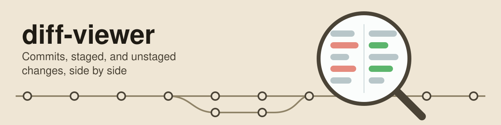

# diff-viewer

A read-only macOS desktop app that shows git changes side by side. Pick a repository, then a commit, the staged changes, or the unstaged changes. Each changed file opens in two columns, old on the left and new on the right, with syntax highlighting and the changed words marked.

Use it when diffs in the terminal (`git show`, `git diff`) are hard to follow. The app does one job and never changes a repository. It highlights each whole file version, so multi-line strings and comments keep their colors inside a change.

Runs on macOS on Apple silicon only, for now. Provided as is, without warranty; see [LICENSE](LICENSE).

Try it with Node 24 and git installed:

```sh
git clone https://github.com/amrendra18/diff-viewer.git && cd diff-viewer
npm ci --ignore-scripts && electron_config_cache="$PWD/.local/electron-cache" node node_modules/electron/install.js && scripts/start --open /path/to/repository
```

## Contents

1. [Requirements](#requirements)
2. [Install](#install)
3. [Update](#update)
4. [Use from scripts and coding agents](#use-from-scripts-and-coding-agents)
5. [What install writes](#what-install-writes)
6. [Using the app](#using-the-app)
7. [Special cases](#special-cases)
8. [What the app reads and stores](#what-the-app-reads-and-stores)
9. [Remove](#remove)
10. [How it works](#how-it-works)
11. [Checks and tests](#checks-and-tests)
12. [Build a Mac app](#build-a-mac-app)
13. [License](#license)

## Requirements

1. macOS on Apple silicon. The test harness (`scripts/verify`) checks for it, and `scripts/package` builds for it only.
2. Node 24.20.0 or a later Node 24 release (`engines` in `package.json`).
3. git on your `PATH`. The checks ran on git 2.39.5. Repositories in git's SHA-256 format need git 2.29 or newer.

## Install

Run this block from a diff-viewer checkout (the `git clone` line above makes one). It builds the local Mac app and links the `diff-viewer` command into `~/.local/bin`.

```sh
npm ci --ignore-scripts
electron_config_cache="$PWD/.local/electron-cache" node node_modules/electron/install.js
scripts/package
mkdir -p "$HOME/.local/bin"
ln -s "$PWD/bin/diff-viewer" "$HOME/.local/bin/diff-viewer"
export PATH="$HOME/.local/bin:$PATH"
diff-viewer --version
```

The `export PATH` line lasts only for the current shell. To keep `diff-viewer` in new terminals, add that line to `~/.zshrc` (skip this if `~/.local/bin` is already on your PATH). The command needs this checkout and Node on PATH. `npm ci --ignore-scripts` installs the exact versions in `package-lock.json` without running package install scripts. The next line downloads Electron 44.4.5 and checks its published checksum. To update an existing link, remove that link before running the block again.

Daily use from any folder. A relative path works, and without `--format json` the command prints one line of text:

```sh
diff-viewer open .
diff-viewer open /absolute/path/to/repository --format json
diff-viewer open /absolute/path/to/repository --source unstaged --format json
diff-viewer open /absolute/path/to/repository --source staged --format json
diff-viewer open /absolute/path/to/repository --source commit:HEAD --format json
diff-viewer --version --format json
```

`open` returns after the requested view appears and leaves the app running. Quit it with Command-Q. A second call with the same app data folder reaches the running app. It brings that repository's window forward, or opens a new window for a new repository. With `--source`, it switches that window to the requested view. `--source commit:REV` accepts a Git revision such as `HEAD` and reports its full commit hash. If the selected view has no changed files, JSON reports `firstFile: null`.

## Update

The `diff-viewer` command starts the app built in `.local/build/`. That build stays old after `git pull` until `scripts/package` runs again. Quit the app with Command-Q, then run this block from the checkout:

```sh
git pull
npm ci --ignore-scripts
electron_config_cache="$PWD/.local/electron-cache" node node_modules/electron/install.js
scripts/package
diff-viewer --version
```

`diff-viewer --version` then reports the new Git revision. It names the app built in `.local/build`. An app that is already running keeps its old build until you quit it with Command-Q, so quit it before the update. The link in `~/.local/bin` needs no change.

## Use from scripts and coding agents

The command has two verbs, `open` and `help`, and never asks for input. With `--format json`, stdout holds exactly one result or error object.

1. An `open` result names the repository, `app: started` or `app: running`, the owning process ID, the window `title`, `visible: true`, and the requested source and first file when supplied.
2. An error object has one field, `error`, which holds `code`, `message`, and `next` (a list with one next step).
3. Exit codes: 0 opened or shown, 1 could not open (for `--version`, the build identity is damaged), 2 bad call.

The error codes for a repository:

| # | Code | Meaning |
| --- | --- | --- |
| 1 | `git-missing` | git is not on PATH. |
| 2 | `not-a-repository` | git found no repository at that path, or the folder does not exist. |
| 3 | `git-failed` | git could not read the repository for another reason, such as a broken `.git/config` or a commit object git cannot read. `message` holds git's own error line. |
| 4 | `unknown-commit` | git knows no commit by the name given in `--source commit:REV`. |
| 5 | `app-not-ready` | The app gave no answer within 20 seconds. |

How `open` behaves with an app or a window that already exists:

1. When an app that is already running cannot open the repository or the source, the command returns the app's code and message at once.
2. When the app it starts cannot open the repository or the source, the command also returns the app's code and message at once. The app keeps running when its window shows the repository.
3. When the repository already has a window, `open` waits until that window shows the repository view, also without `--source`. A card over the repository, such as a failed pick from the recent list, is closed first.
4. A window that could not load its repository tries again, and reports git's message when it fails again.

`diff-viewer --help` and `diff-viewer open --help` list inputs, outputs, effects, and exit codes. `diff-viewer help --format json` prints the same help as one JSON object. So do `diff-viewer --help --format json` and `diff-viewer open --help --format json`. The help lists every error code. `diff-viewer --version --format json` reports the package version, the full Git revision, and whether the checkout had uncommitted changes when `scripts/package` built the app. Before the first `scripts/package` run, the revision is `unknown`. `tests/launcher.test.mts` checks the help, version, and error outputs during `./scripts/check fast`.

A line you can give a coding agent: "When `diff-viewer` is on PATH, run `diff-viewer open <path> --source unstaged --format json` and report its object; otherwise inspect changes with git."

## What install writes

The install block writes `node_modules/`, `dist/`, `.local/npm-cache/`, `.local/electron-cache/`, and `.local/build/` inside this checkout, plus the link `~/.local/bin/diff-viewer`. It downloads the pinned Node packages and the Electron binary. Nothing else uses the network. `open` writes its own app data in `~/Library/Application Support/diff-viewer`. Set `DIFF_VIEWER_STATE_DIR` to an absolute folder to keep a run's data elsewhere. The app data includes `recent.json` and Electron's Chromium files. macOS also writes `~/Library/Preferences/local.diff-viewer.plist` when the packaged app runs; it holds only system settings such as text direction.

## Using the app

1. **Read a commit.** Click "Open repository…" and pick a folder. The repository opens in its own window. The left pane has two parts with a draggable divider. The bottom part has three tabs: "Staged", "Unstaged", and "Commits". The Commits tab lists the current branch's commits, newest first, under a box where you can paste any commit hash and press Return. Click a commit. The top part lists its changed files with a status letter (A, M, D, R, U) and the added and removed line counts. The first file opens in two columns with line numbers. Changed lines are tinted, and changed words inside them get a stronger tint. Each change shows 3 lines of context. A bar such as "Show 42 hidden lines" expands the unchanged lines between changes.
2. **Read staged changes.** Click the "Staged" tab. The view is the same, comparing the last commit with the staged files.
3. **Read unstaged changes.** Click the "Unstaged" tab. The view compares the staged files with the files on disk. Untracked files appear as new files.
4. **Come back later.** Click the repository name in the header (or "No repository") to see the last 10 repositories. The staged and unstaged views refresh when the window gets focus, and the Refresh button refreshes on demand; its icon turns while a refresh runs.
5. **Move around.** Command-B hides and shows the left pane. `]` and `[` open the next and previous file, also while the pane is hidden. Opening a repository that is already open brings its window forward.

The app follows the system's light or dark mode while it runs.

## Special cases

1. **No repository yet.** A first-run screen with an "Open repository…" button and the recent list. The `diff-viewer` command always opens a repository, so this screen shows when the app starts without one: `scripts/start` with no `--open`.
2. **Not a git repository.** A message naming the folder, with "Choose another folder…".
3. **Nothing changed.** "No staged changes" or "No unstaged changes".
4. **Binary file.** "Binary file, not shown", with the old and new sizes.
5. **Very large file.** A file or diff over 5,000 lines, or a file over 200 KB, stays collapsed with its line count or size and a "Show anyway" button. A file that takes over 2 s to highlight shows as plain text (next item), so "Show anyway" on a large file can show it without colors.
6. **File that takes over 2 s to highlight.** The file shows as plain text after 2 s, whatever its size. A small file can do this when one long line makes a grammar very slow. Windows keep answering during the wait, but all windows share one highlighter, one file at a time. So a file waits about 2 s for each slow file ahead of it.
7. **Merge commit.** The diff compares with the first parent, and a banner says so.
8. **First commit of a repository.** Every file shows as added. The oldest commit of a shallow clone shows the same way, because git holds no parent for it.
9. **Renamed file.** The list shows "old path → new path", with the diff of any content change.
10. **Submodule, symbolic link, or mode change.** A submodule shows its old and new commit, a symbolic link shows its old and new target (the app never follows it), and a mode-only change shows the old and new file mode.
11. **Merge conflict.** A conflicted file shows once, in the Unstaged tab, with a notice.
12. **Bare repository.** It opens with its commits only, with no Staged or Unstaged tabs.
13. **Repository removed while open.** The window shows "This repository is no longer there".
14. **Text that is not UTF-8.** The app reads all text as UTF-8. A file in another encoding, such as Latin-1 or Shift-JIS, shows the replacement character "�" where its bytes are not valid UTF-8. A change to such bytes alone can show no visible difference. A file name that is not valid UTF-8 shows the same character, and opening that file shows "This file is not among the changes".
15. **Working file that git converts.** A clean filter, such as the one git-lfs uses, or a `working-tree-encoding` attribute changes a file before git compares it. The Unstaged tab shows "This file could not be read" when that changes the file's line count, because git's diff no longer fits the file on disk. Git's comparison and the app's copy of the file can also differ with the same line count. The app then shows the file on disk with git's marks.

## What the app reads and stores

1. For a commit: the commit's details and both versions of each changed file, from git's object store.
2. For staged changes: the index (git's staging area) and the last commit.
3. For unstaged changes: the files on disk that git reports as changed or untracked. Untracked files that `.gitignore` excludes are never read. A tracked file is read when git lists it as changed, even if it matches `.gitignore`.
4. The app stores paths of the last 10 repositories in `recent.json`. Electron also stores Chromium data in the same app data folder. The `diff-viewer` command keeps this data in `~/Library/Application Support/diff-viewer` unless `DIFF_VIEWER_STATE_DIR` names another absolute folder.
5. Nothing leaves the machine. The app's main process has no network code, and git is never asked to fetch: a partial clone's missing file data stays missing (unit test `partial-clone-no-fetch`). The harness counts the page's network requests and checks that the count is 0. It does not watch the main process.
6. The app never writes to a repository, apart from a filter program git runs (item 7). It runs git with fixed arguments and no shell, and only commands that read. The test harness compares a fingerprint of each test repository, `.git` included, before and after every run.
7. The app trusts a repository's own `.git/config`, as git does. That file can name a filter program for some files (with a `filter=` line in `.gitattributes`). Git runs that program each time the app opens or refreshes a repository and when it reads unstaged changes, just as `git status` would. A clone never copies `.git/config` from its source, so the risk comes from a `.git` folder made by someone else, such as one inside a downloaded archive. Open such a folder only if you trust who made it. A filter program can also write into `.git` on its own. For example, git-lfs stores file content in its cache under `.git/lfs/objects`. It does the same when you run `git status`.

Will never be added: staging, editing, committing, or any other change to a repository; network access; hosted git services.

Not built yet: "Open in diff-viewer" from Finder's right-click menu.

## Remove

Quit the app with Command-Q. Remove the `~/.local/bin/diff-viewer` link, and the `export PATH` line from `~/.zshrc` if you added it and nothing else uses `~/.local/bin`. You can then remove the checkout and `~/Library/Application Support/diff-viewer` if you no longer need its recent-repository list or Electron data. Also remove `~/Library/Preferences/local.diff-viewer.plist`. A folder selected through `DIFF_VIEWER_STATE_DIR` is separate and can be removed on its own.

## How it works

1. **Read-only git.** The main process runs only git commands that read, with fixed arguments and no shell. [AGENTS.md](AGENTS.md) rule 2 lists them and explains why `git diff` is left out. `src/app/git-settings.ts` pins each of your own git settings that would change what the app parses.
2. **A closed page.** The page has no Node access. The preload exposes one small API, and the main process checks every message from the page. Commit subjects, names, paths, and file contents are shown as plain text.
3. **Whole-file highlighting.** [Shiki](https://shiki.style) highlights each whole file version with GitHub's light and dark themes. It runs on one worker thread, one file at a time, so a slow file cannot stop the main process. A file gets 2 s of grammar work. The main process then ends the worker, shows that file as plain text, and starts a fresh worker for the next file. Only plain hex colors come back from the worker. The page then shows git's diff of the file, with 3 lines of context and rename detection.
4. **Code layout.**
   1. `src/app/` is the main process: the window, git, the recent list, and the message checks (`boundary.ts`). It also holds the highlighter (`highlight.ts`), which runs on its worker thread (`highlight-worker.ts`) and is reached through `highlight-client.mts`.
   2. `src/domain/` is pure code: side-by-side rows (`diff.ts`), changed-word marks (`words.ts`), and the contract between main and page (`types.ts`).
   3. `src/web/` is the page, in plain DOM and CSS, with no UI framework.
   4. `bin/diff-viewer` is the installed command. It checks its arguments, then starts the packaged app or hands the request to the app that is already running.
   5. `scripts/` holds the build, check, test harness, and packaging scripts. `tests/` holds the unit tests.

Stack: Electron 44.4.5, TypeScript 5.9.3, Node 24, Shiki 4.4.3, and Playwright for the harness.

## Checks and tests

`./scripts/check fast` builds the app and runs type checks, lint, and unit tests. [CONTRIBUTING.md](CONTRIBUTING.md#checks) lists every check and when to run it.

## Build a Mac app

`scripts/package` builds `.local/build/diff-viewer.app` and signs it ad hoc (`codesign --sign -`), so it runs on your own Mac with no Apple developer account. The bundle is not notarized, so other Macs will refuse to open it.

## License

MIT License. See [LICENSE](LICENSE).
